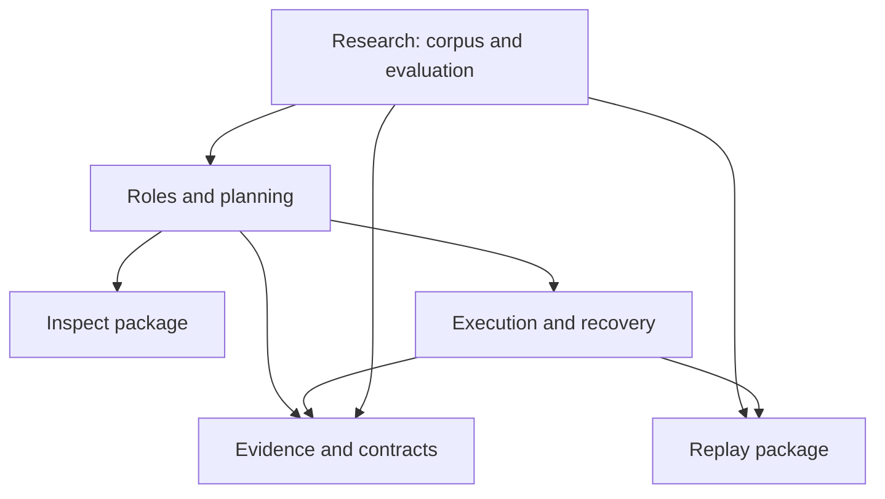

# Cognitive OS: карта проекта
[Проверка извлечённых знаний,03.10](docs/architecture/knowledge_audit_20261003.md):
архетипы верны 2/20 на новых проектах, pickle 11 исправлений/200, реальные цели 0/27
в классах компетенций. Opt-in `tools/develop_feature.py --competency-first` —
маршрут без LLM через `runtime/feature_competency.py` и `config/task_competencies.json`.


[Завершение map и свежая тройка,30.09](docs/architecture/map_completion_20260930.md): **1/2 старых map**, **1/3 frozen новых**, **2/3 с продолжением**.
Оригиналы неизменны; полные копии map проверяются отдельно, без объединения патчей.
Пакет2665307/3000000,cumulative8038954,unknown0.
Quote не закрыт; кандидат проходит диагностику в полной копии. Приоритет —
сохранение непринятого черновика при точечных исправлениях, затем DNS и аудит.
Баллы ролей не повышены; старые исходы и затраты сохранены.

[Актуальность аудита и управляемая остановка, 30.09](docs/architecture/audit_feedback_20260930.md):
при смене политики прежние замечания сохраняются для переоценки аудитором,
но больше не выдаются SpecWriter как действующие требования. История связана
с goal/design/source и переживает resume. `STOP` останавливает следующий
модельный вызов после сохранения текущего ответа и usage. Новых LLM-вызовов0;
старые результаты, ledger и оценки ролей сохранены. Проверки и ограничения —
в отчёте; итоговый receipt `artifacts/audit_feedback_20260930/stage-final.json`.

[Парное сравнение и полный VR,30.09](docs/architecture/paired_workflow_20260930.md):
**Полный аудит0/3, условный1/3** при одинаковых350000 на запуск; значительная
экономия не доказана. После двух общих исправлений COS сама закрыла дуги в полной
копии VR:121 native passed,1 прежний skip,8 внешних,регрессий0. Оригиналы неизменны.
Весь этап1075306/3000000, cumulative6448953,unknown0; ledger в
`artifacts/paired_workflow_20260930/ledger-pointer.json`. Default и оценки ролей
не изменены. Старые задачи quote/alias остаются открыты. Следующий приоритет —
актуальность обратной связи при смене контракта; старые неуспехи не переписывать.

[Переиспользование проверенных данных,30.09](docs/architecture/accepted_metadata_20260930.md):
**3/5 исходных задач +1/1 дополнительная VR завершены**. Дуги закрыты COS:
9 native +8 внешних, оба прежних контрпримера обнаруживаются. Последний запуск —
один Reviewer,7537 токенов; весь этап26336 с неудачной попыткой Programmer.
Серия1773300/2млн,cumulative5373647,unknown0. Два следующих запроса map не
помещаются с резервом; ledger/checkpoints сохранены. Frozen0/5 и баллы не меняются.
Финальная регрессия157passed, пакеты60passed, архитектура5/5,400 строк соблюдены.

[Разделение новых требований и preservation,30.09](docs/architecture/assertion_controls_20260930.md):
**2/5 исходных задач +1/1 дополнительная VR завершены** после ремонта COS,
55 native +13 внешних проверок. Ещё два кандидата проходят16 native +11 внешних,
но полный цикл не закрыт. Исходный frozen0/5 сохранён. Расход1746964/2млн,
cumulative5347311,unknown0; следующий запрос не помещается с резервом.
Контрпримеры/оплаченные черновики сохранены; общие баллы и экономия не доказаны.
Проверки: финальный handoff149passed, архитектура5/5,400 строк. Полный core5196passed/1failed/6skipped; найденный Windows lock-release сбой исправлен и проверен17/17, полный набор после исправления не повторялся. Пакеты60passed, плагины285passed.

[Новая пятёрка и ремонт цикла,30.09](docs/architecture/roles_fresh_20260930.md): **0/5 закрытых задач** при цели4/5. Два кандидата проходят25 native +7 внешних, но полный цикл не завершён. Общие исправления проверены; экономия и рост баллов не доказаны.748206 новых/1млн,cumulative4348553,unknown0. Продолжения также заблокированы резервом бюджета; оригиналы проектов неизменны.

[Проверка ожиданий до заморозки,30.09](docs/architecture/baseline_expectations_20260930.md): COS закрыла оставшуюся CSV-задачу:20 native +3 внешних проверки; два прежних контрпримера теперь обнаруживаются. Персональные прогнозы baseline и перенос Challenger между resume реализованы.102514 новых токенов,cumulative3600347,unknown0. Все5 известных задач завершены с исправляющими продолжениями; исходный frozen3/5 и общие баллы ролей не повышаются.


[Проверяемый пересмотр приёмки,30.09](docs/architecture/spec_dispute_20260930.md):
повторы одинакового кандидата останавливаются; конфликт тестов рассматривается
по исходникам, native-свидетельству и отдельному аудиту. COS закрыла прежнюю задачу:
25 native +10 внешних,204650 новых токенов. Frozen3/5 остаётся историческим итогом.

[Новая фиксированная выборка,30.09](docs/architecture/roles_cohort_20260930.md):
3/5 без ремонта COS при цели4/5;21 native +17 внешних проверок. Найдены
конфликт frozen specification и повторение неизменного кандидата.562108 новых
токенов; контроль цены не завершён. Оригиналы проектов и снимки COS неизменны.

[Контрпримеры и аудит,30.09](docs/architecture/roles_obligations_20260930.md):
исправлена потеря валидных контрпримеров при повторе Challenger; сохранённый сбой
воспроизведён без новых LLM-вызовов.361/361 профильных тестов. Совместный аудит
замечаний реализован; влияние на реальную стоимость ещё требует измерения.

[Пакет завершения и стоимости ролей](docs/architecture/roles_efficiency_20260929.md):
прежний GeoJSON и пять новых задач доведены; 98 native +54 внешних проверки.
Без ремонта COS — 2/5 при цели4/5; продолжения после ремонта считаются отдельно.
Новый расход1139191/2млн. Следующий приоритет — сохранение всех подтверждённых
контрпримеров и сокращение повторных циклов SpecWriter/аудита.

[Документ для системного архитектора](docs/architecture/SYSTEM_ARCHITECT_REVIEW.md):
назначение, устройство, контракты, границы доверия, evidence и вопросы для ревью.
Срез на 29.09.2026, с отделением реализованного от целевой архитектуры.

[Новый пакет переносимости](docs/architecture/roles_transfer_20260929.md): 4/5 закрытых задач,
проверенная установка/откат в копии VR; незавершённый цикл и расходы сохранены.

[Три реальные задачи и файловый ремонт COS](docs/architecture/roles_package_20260929.md):
73/73 внешней приёмки, локальные оценки первых трёх ролей и сохранённые неудачи.

[Постоянная служба файлового worker](docs/architecture/remote_worker_service_20260928.md):
SCM host, отдельный runtime и проверяемый установочный пакет.
[Установка проверена](docs/architecture/remote_worker_live_20260928.md): ACL и
offline-допуск ролей проходят. [Живой прогон на 8200](docs/architecture/remote_worker_8200_20260929.md)
завершён: 23/23 native +36/36 внешних проверок, учёт кэша сохраняет историю.

[Удалённая помощь COS через сообщения](docs/architecture/remote_support.md):
отдельный контроллер, файловый транспорт, проверка патча и продолжение задания.
Внешний помощник работает с экспортированным пакетом; прямой доступ не требуется.
[Живой ролевой пилот](docs/architecture/remote_role_support_20260928.md):
checkpoint adapter сохраняет принятую спецификацию, возобновляет Programmer
и завершает задачу независимой приёмкой; ограничения и вмешательства указаны.
[Раздельные Windows-права и аварийный учёт](docs/architecture/remote_support_recovery_20260928.md):
локальный файловый worker, резерв контроллера, проверка жёстких остановок.

Проект связывает цель, ролевые артефакты, контролируемое исполнение и проверяемые
результаты. В целом это исследовательская платформа. Текущее состояние и
доказательства собраны в [DEVELOPMENT_STATUS.md](DEVELOPMENT_STATUS.md).
Незавершённые структурные задачи для ассистента автоматически сохраняются в
[очереди](DEVELOPMENT_TASKS.json); [порядок продолжения](DEVELOPMENT_TASKS.md)
помогает подхватить их при следующем этапе без напоминания пользователя.

Приоритеты дальнейшей работы: [проверенный результат и достаточный локальный
контекст](docs/architecture/development_workflow.md). Общий размер архитектуры
вторичен; границы компонентов и проверка последствий изменений обязательны.

Целевая организация знаний: [плагины компетенций с собственной KB](docs/architecture/plugin_owned_knowledge.md).
Общий слой сохраняет каталог, протоколы, контекст задачи и журнал доказательств.
Первый [пилот pickle](docs/architecture/pickle_competency_20260915.md) выделяет
рабочий механизм и убирает его специальные ветки из общего интерпретатора;
миграция остальных знаний и исследовательских инструментов продолжается отдельно.

Второй владелец — [append mapping](docs/architecture/append_mapping_owner_20260915.md):
профиль границы и контраст в локальной KB;
[извлекатель](docs/architecture/append_mapping_extractor_20260915.md) использует
общие AST-функции Inspect. [Рецепт](docs/architecture/append_mapping_recipe_20260915.md)
также принадлежит плагину. [Общий контракт результата](docs/architecture/helper_recovery_contract_20260915.md)
отделяет его метаданные от координации кандидатов и применения в runtime.

Третий владелец — [JSON serialization](docs/architecture/json_serialization_20260916.md):
рецепт, алгоритм и результат извлечения helper в отдельном плагине;
общая координация и исследовательское распознавание сохраняют прежние границы.

Четвёртый владелец — [JSON parsing](docs/architecture/json_parsing_20260916.md):
извлечение helper из inline json.loads/read_text, с прежними контрактами
и отдельной от сетевого parsing областью.

Пятый владелец — [text splitting](docs/architecture/text_splitting_20260916.md):
последний из четырёх текущих helper extractors. Их runtime-модуль содержит
совместимые импорты; алгоритмы, recipe и metadata принадлежат плагинам.

[Выбор helper recipe](docs/architecture/helper_recipe_reads_20260916.md) читает
каталог один раз; следующий кандидат и verifier повторяют свежий допуск.

Для описания назначения и пользовательских сценариев проекта используйте
`tools/describe_project.py`: [компетенция описания](plugins/project_description/README.md)
владеет отбором свидетельств и правилами объяснения; runtime организует модельные
черновик/review и проверяет ссылки на источники.

Цели и критерии ролевой зрелости: [DEVELOPMENT_PLAN_97.md](DEVELOPMENT_PLAN_97.md).
Текущий фокус — [Analyzer → Architect → SpecWriter](docs/architecture/upstream_roles_20260913.md):
контракт задачи, происхождение выводов, конкретный причинный дизайн.

| Подсистема | Где начинать | Ответственность |
|---|---|---|
| [Inspect](docs/architecture/inspect.md) | `packages/cognitive-inspect/src/cognitive_inspect/` | Факты о дереве, стеке, Python и командах |
| [Replay](docs/architecture/replay.md) | `packages/cognitive-replay/src/cognitive_replay/` | Повтор дефекта, проверка upstream fix и окружения |
| [Execution](docs/architecture/execution.md) | `runtime/executor.py`, `runtime/durable_queue.py` | Исполнение pipeline, очередь, leases, восстановление |
| [Evidence](docs/architecture/evidence.md) | `runtime/evidence_ledger.py`, `runtime/schema.py` | Контракты, целостность доказательств, проверка схем |
| [Roles](docs/architecture/roles.md) | `runtime/configured_role_pipeline.py` | Анализ, планы, спецификации, роль исполнения и review |
| [Research](docs/architecture/research.md) | `runtime/local_historical_defect_mining.py`, `runtime/three_route_evaluation.py` | Корпус, обучение, независимая оценка и допуск |

Это смысловые области, а не шесть независимых продуктов. Inspect и Replay уже
имеют отдельные Python-пакеты; остальные области пока сохраняют существующие
пути. Список точек входа, контрактов, тестов и связей хранится в
[subsystems.json](docs/architecture/subsystems.json) и проверяется инструментом.



Стрелки показывают разрешённое использование на уровне областей; это не полный
граф всех импортов. Оба пакета независимы от runtime, ролей и друг от друга.
В существующем native-failure intake остаются циклы; его перенос целиком отложен.

Для конкретной задачи:

```bash
python tools/project_context.py --subsystem replay
python tools/project_context.py --path runtime/durable_queue.py --format json
python tools/project_context.py --subsystem roles --subsystem inspect --output artifacts/context/analysis.md
python tools/project_context.py --check
```

Контекст содержит краткое описание области и ссылки на исходники, а не весь
репозиторий. Политика документации и измерения эффекта:
[architecture/README](docs/architecture/README.md). История:
[history/README](docs/history/README.md).
